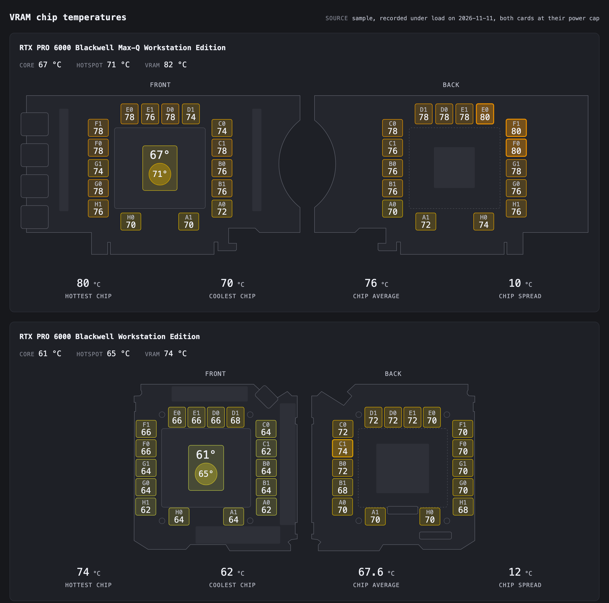
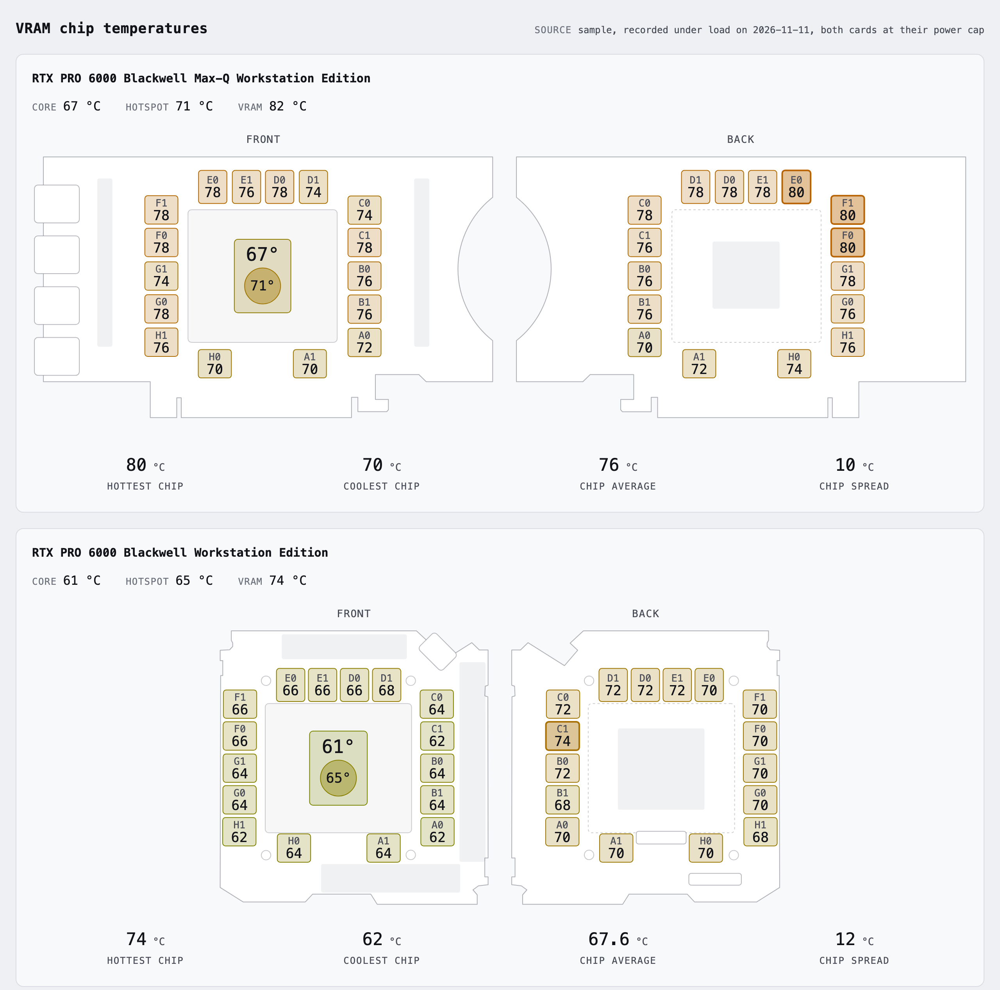
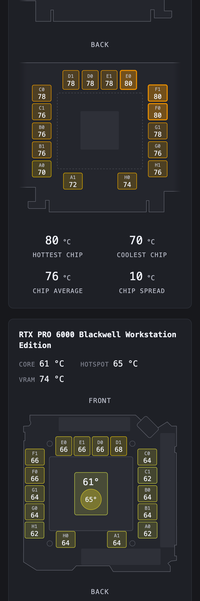

# vram-chip-temps

See the temperature of every memory chip on an NVIDIA RTX PRO 6000 Blackwell, drawn where the
chip sits on the board. Put it in any dashboard you like.



*Real data: both cards at their power cap, recorded with the patched LACT.*

## What it is

An RTX PRO 6000 has 32 memory chips: 16 on the front of the board and 16 on the back. Each chip
has its own temperature sensor. [LACT](https://github.com/ilya-zlobintsev/LACT), the Linux GPU
control tool, reads only 16 of them and shows each reading twice. The other 16 sit on the back,
under a passive back plate, and run hotter. Nothing shows them.

This repo has four parts. Use one or all of them:

| Part | What it does |
|---|---|
| [LACT patch](lact/) | Makes LACT read all 32 chips. |
| [Board view](web/) | A small web module that draws the front and back of the board with each chip at its real place, coloured by temperature. No dependencies, no build step. |
| [Chip map](web/chip-map.json) | Where each chip sits, in millimetres. For dashboards that draw their own picture. |
| [Bridge](bridge/lact-chip-temps.py) | A tiny Python server: LACT readings as JSON and as Prometheus metrics. |

What it found: under load on the Workstation Edition, the back chip heated up more than the
front chip at all 16 places, by 4 to 5 °C on average.

## Try it

See the demo with recorded data (any computer):

```sh
git clone https://github.com/EspenJD/vram-chip-temps.git
cd vram-chip-temps
python3 -m http.server 8000
```

Open <http://127.0.0.1:8000/demo/>.

Live data (Linux, with LACT running):

```sh
python3 bridge/lact-chip-temps.py
```

Open <http://127.0.0.1:9737/>. With stock LACT the back of the board stays empty; install the
patch to fill it.

## Install the LACT patch

The patch changes the LACT daemon: you build LACT from source with it and run that build in
place of the packaged daemon. The steps (build, install, check, undo) are in
[AGENTS.md](AGENTS.md). You can also give that file to an AI coding agent and ask it to set
this up.

Restarting the LACT daemon applies your GPU settings again, so do it while the GPUs are idle.

## Use it in your dashboard

- **A web page:** load `web/chip-view.js` and `web/chip-view.css`, then pass the readings to
  `ChipView`. [Example](AGENTS.md#feed-a-dashboard).
- **Grafana / Prometheus:** scrape the bridge at `/metrics`. Each chip is one series of
  `lact_temperature_celsius`, with labels for the card, the chip and the chip's side (`ic`).
- **Home Assistant, scripts, anything else:** read `/temps.json` from the bridge, or run
  `python3 bridge/lact-chip-temps.py --once`.
- **Your own drawing:** use the chip positions in `web/chip-map.json`.

## Cards

| Card | Board drawing | Patch tested |
|---|---|---|
| RTX PRO 6000 Blackwell Workstation Edition | yes | yes |
| RTX PRO 6000 Blackwell Max-Q Workstation Edition | yes | yes |
| Other cards with per-chip sensors in LACT | a plain grid of chips | GDDR6X and single-sided cards keep stock LACT behaviour |

<p>
  
  
</p>

The view follows the system's light or dark mode and fits phone screens.

## How sure is the map

The chip positions were measured from teardown photos. NVIDIA does not publish which chip is
where on these boards, so the letter-to-place map comes from a partner card's schematic with
the same GPU and was then checked against load recordings on both cards. Which of the two chips
at a place is on the back comes from how they heat up, not from looking at the board. Details
and confidence: [docs/chip-map.md](docs/chip-map.md).

## Credits

- [LACT](https://github.com/ilya-zlobintsev/LACT) by Ilya Zlobintsev and its contributors. The
  patch changes LACT's code and is under LACT's MIT license.
- Teardown and bare-board photos of these cards published by reviewers and owners, and a
  partner RTX 5090 schematic, for the board layout.
- Written with [Claude Code](https://claude.com/claude-code).

## License

[MIT](LICENSE)
